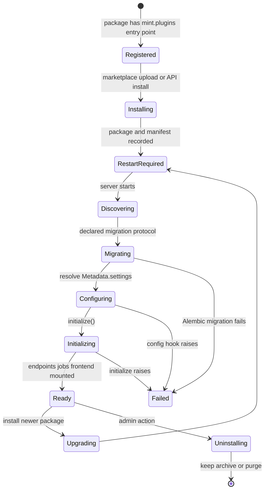

# Plugin lifecycle

A plugin has two lifecycles:

| Lifecycle | Who cares | Key question |
|-----------|-----------|--------------|
| **Install lifecycle** | Lab admins | Is the package installed, compatible, and active after restart? |
| **Runtime lifecycle** | Plugin authors | Which plugin methods or decorators run at startup, request time, and shutdown? |

Knowing the difference helps you put code in the right place. Schema setup goes
in migrations, startup resources go in `initialize()`, typed config side effects
go in `@on("settings")`, status reporting goes in `@health`, and route
logic goes in `@endpoint` handlers or native routers.

## State diagram



## Phase by phase

### Registered

Your plugin is published as a `.mint` bundle. Its internal Python wheel declares an entry point in the `mint.plugins` group:

```toml
# pyproject.toml
[project.entry-points."mint.plugins"]
my-plugin = "my_plugin.plugin:MyPlugin"
```

The entry-point name is the **install slug** (URL-safe, hyphenated). The right-hand side is the dotted import path to the `Plugin` subclass. The entry-point group is `mint.plugins`; a plugin that still declares `mld.plugins` is not discovered, and there is no error.

Put package name, description, authors, homepage, and license in the PEP 621
`[project]` table. Preserve the scaffold's dynamic `hatch-vcs` version configuration;
the built wheel records the Git-derived package version. Declare runtime
behavior with a `Metadata` subclass and `@plugin`:

```python
from mint_sdk import Metadata, Plugin, plugin

class PeakQcMeta(Metadata):
    domain = "lcms"
    prefix = "/peak-qc"

@plugin(PeakQcMeta)
class PeakQcPlugin(Plugin):
    ...
```

The platform discovers entry points on every startup when `plugins.loadFromEntryPoints` is `true` (default).

### Installing

Triggered by **Admin -> Plugins -> Registry -> Install**, bundle upload,
or an admin install request through the platform API. The platform:

1. Resolves the `.mint` bundle from an upload or a registry-linked GitHub Release.
2. Checks marketplace `min_platform_version` and bundle `[tool.mint].requires_mint`.
3. Refuses a plugin wheel whose `mint-sdk` requirement excludes the platform SDK.
4. Compiles the requirements of all in-process plugins against the platform lock (`uv pip compile --generate-hashes --only-binary :all:`). A compile that fails is the conflict check.
5. Applies the new `plugins.lock` and records the source artifact in the plugin manifest.
6. Keeps the ten most recent previous locks, so an admin can roll back.

Most successful installs report that a server restart is required. Until that
restart/load cycle completes, the package may be installed but not serving
traffic.

### Migrating

On the normal installed entry-point path, database preparation happens before typed startup configuration and `initialize()`. The platform applies the Alembic revisions of `Metadata.database` under its migration lock. See [Migrations](/sdk/concepts/migrations) for startup behavior, failure handling and recovery. The platform disables an in-process plugin that still defines the removed `get_migrations_package()`.

### Configuring

If the `Metadata` sets `settings = SettingsModel`, MINT loads the durable
plugin settings, validates them with the Pydantic model, and then runs matching
`@on("settings")` handlers before `initialize()`.

```python
from pydantic import BaseModel, Field
from mint_sdk import Metadata, Plugin, SettingsChange, on, plugin

class PeakQcSettings(BaseModel):
    min_signal: float = Field(1000, ge=0)

class PeakQcMeta(Metadata):
    domain = "lcms"
    prefix = "/peak-qc"
    settings = PeakQcSettings

@plugin(PeakQcMeta)
class PeakQcPlugin(Plugin[PeakQcSettings]):
    @on("settings")
    def apply_config(self, change: SettingsChange[PeakQcSettings]) -> None:
        self._min_signal = change.current.min_signal
```

Startup settings hook failures stop plugin initialization. Keep config side
effects here; do not create a second plugin-owned config file for integrated
mode.

### Initializing

The host attaches `self.context`, then calls `await plugin.initialize()`:

- `initialize()` takes no argument. `self.context` is a `PlatformContext` when integrated, and a `StandaloneContext` when standalone. It is never `None`; use `self.is_standalone` to branch.
- Use this hook to: open external clients, populate caches, use already validated typed settings
- The hook is awaited; routes don't mount until it returns
- Raise `PluginLifecycleException` (or any exception) to abort initialization
- You only override it when the plugin owns startup resources.

```python
from mint_sdk import Plugin
from mint_sdk.exceptions import PluginLifecycleException

class MyPlugin(Plugin):
    async def initialize(self) -> None:
        if not self._validate_config():
            raise PluginLifecycleException(
                "MyPlugin requires 'thresholds' in plugin settings",
                phase="initialize",
                plugin_name=self.name,
            )
```

### Ready

The SDK resolves all plugin surfaces and MINT mounts them under
`routes_prefix`:

| Surface | How authors declare it |
|---------|------------------------|
| HTTP endpoints | `@endpoint.get/post/...` or native `routers()` |
| Experiment-scoped route groups | `@endpoint.group(..., scope="experiment")` |
| Jobs | `@job(Spec)` methods, mounted under the SDK-owned jobs runtime |
| Generated UI | `ui = "generated"` plus generated job/result metadata |
| Frontend assets | The packaged frontend build, auto-detected |
| Native routers | `RouterMount` from `routers()` for escape hatches |
| MCP | `@tool`, `@prompt`, `@resource` (`mint_sdk.mcp`) |

The plugin tile becomes visible to users whose role has `plugins.use` and can see the plugin. Each endpoint, job, tool and page then applies its `access` level (`use`, `configure`, `admin`). HTTP requests start arriving after this point.

While ready, the platform or SDK runtime may also call:

| Hook | When |
|------|------|
| `@health` | Periodically from the platform, at `GET /__mint/health`, and on demand from admin status |
| `@on("experiment.before_save")` | Before platform design-data save; may veto the write |
| `@on("experiment.after_save")` | After platform design-data save |
| `@on("experiment.status_changed")` | Status flip such as `ongoing -> completed` |
| `@on("experiment.created")`, `@on("experiment.updated")`, `@on("experiment.deleted")` | After the platform commits the write |
| `@on("settings")` | When platform plugin settings are saved/reset or applied at startup |
| `@notify` | When plugin code returns a typed notification event |
| `@calendar_event` | When plugin code returns or cancels a typed calendar event |

A plugin gets only the events that it declares with `@on`. The writing plugin does not receive the events of its own write. The legacy lifecycle overrides (`on_before_experiment_save()` and similar) and `check_health()` are removed.

### Upgrading

A marketplace upgrade is a package install followed by a load cycle:

1. Install the new wheel
2. Record the new manifest/registry metadata
3. Report restart-required state when the new code is not active yet
4. On restart, discover the new entry point metadata
5. Run any new migrations
6. Resolve config, run startup hooks, call `initialize()`, and mount surfaces

A plugin built for an older SDK cannot load on a newer platform. At the first start of a new minor, the platform disables an in-process plugin whose wheel excludes the platform `mint-sdk` and uninstalls its packages. A plugin process whose cached wheel excludes it does not start. The plugin data stays. Install the release of the plugin for the new SDK to enable it again; `GET /api/plugins` shows the reason in `dependency_lock`.

Do not assume a marketplace update hot-swaps the running plugin. In the current
platform, installed packages can appear as **Installed but not loaded yet** or
**Pending restart** until the server reloads.

### Uninstalling

The admin chooses one of three modes:

| Mode | Effect on plugin-owned data |
|------|-----------------------------|
| **keep** (default) | Tables and rows remain. Reinstalling the plugin restores access. |
| **archive** | Plugin schema is renamed to an archived schema; recovery requires administrator database work. |
| **purge** | Tables, rows, and uploaded artifacts dropped. Irreversible. |

The browser UI and normal CLI path use the safe default: remove the package and
keep plugin-owned data. The plugin manager also tracks unfinished cleanup for
manifest, notification, and calendar data so interrupted uninstalls can be
finalized later.

## Shutdown and resource cleanup

When the host stops or unloads the plugin, close plugin-owned clients and tasks in `shutdown()`.

```python
import httpx
from mint_sdk import Plugin

class MyPlugin(Plugin):
    async def initialize(self) -> None:
        self._http = httpx.AsyncClient(timeout=20.0)

    async def shutdown(self) -> None:
        await self._http.aclose()
```

## Typed events and their limits

Declare handlers with `@on`. A before-save validator should scope itself to its own design payload, because the platform sends the event to every plugin that declares it:

```python
from mint_sdk import BeforeExperimentSave, EventVetoException, on

@on("experiment.before_save")
async def validate_design(self, event: BeforeExperimentSave) -> None:
    if event.data.get("plugin_id") != self.name:
        return None
    payload = event.data.get("data", {})
    if not payload.get("samples"):
        raise EventVetoException("Add at least one sample")
```

For platform design saves, `event.data` contains `{ "plugin_id": ..., "data": ... }`; it is not the inner design payload directly. Typed events also provide `experiment_id` and optional `experiment`, `request_id`, and `actor` information. Do not assume optional context is present for every host path.

`experiment.before_save` is blocking and fails closed. Return `None` to allow the save and raise `EventVetoException` to refuse it (422). A handler failure, a return value other than `None`, or (for a plugin process, Docker-managed or external HTTP runtime) an unreachable runtime, timeout, missing token or error status also refuses the save. The platform sends the event to a plugin process at `/__mint/events`. A handler that raises in an in-process plugin blocks the save too; before 1.4 the platform logged the error and continued. After-save and status handlers are isolated observers; their failures do not roll back the completed operation.

These are platform-service events, not database triggers. The platform design-save path (REST, MCP and plugin writes alike) runs the hooks of the other plugins. Enforce invariants that must apply to every design write with `Metadata.design` (a schema the platform validates on every `design.save`); perform operation-specific validation before calling a repository. Keep hooks fast and avoid saving the same design recursively from its own event handler.

For plugin-local events, use a namespaced name with `await self.context.publish("my-plugin.refreshed", payload)` and a matching `@on("my-plugin.refreshed")` observer. The name must start with the normalized plugin name. This is not a durable job queue or a cross-plugin message bus. With `"realtime"` in `Metadata.features`, `publish` also streams the event to the browser; see [Python SDK](/sdk/api/python#events-health-and-realtime).

## Settings revisions and runtime changes

`@on("settings")` receives a `SettingsChange[Settings]` with the current typed settings, previous settings when available, source, and explicitly supplied fields. Startup hooks run before `initialize()`; later saves run the same side effects. Avoid hooks that require a client not yet opened by `initialize()`.

```python
candidate = self.settings.model_copy(update={"min_signal": 1500})
await self.update_settings(candidate, replace=True, revision=self.settings_revision)

# For a shallow partial update, read/retry against the latest durable snapshot:
await self.update_settings({"min_signal": 1500})
```

Revisions are opaque content ETag/CAS tokens, not increasing migration numbers. A stale full replacement conflicts; it does not merge or retry automatically. A patch is shallow, so a supplied nested object replaces that field rather than deep-merging it. Settings revisions, package versions, Alembic string revisions, and design payload schema versions solve different problems.

For a plugin in its own process (subprocess, Docker-managed or external HTTP), the platform sends a settings write to the plugin process. The plugin validates and stores the value and runs its `@on("settings")` handlers, so no restart is needed. When the plugin process does not answer, the write is a 503 and nothing is stored.

## Failed state

A plugin reaches **Failed** when:

- An Alembic migration fails during `Migrating`, or the plugin still defines `get_migrations_package()`
- `initialize()` raises during `Initializing`
- Typed startup configuration or its change hook fails

Failed plugins are surfaced in admin status with the failure reason. They do
not accept plugin HTTP traffic. Ship a fixed plugin release or fix the
configuration, then restart/reload the server so startup can retry.

## Hook reference

| Surface | Required? | Default / current guidance |
|---------|-----------|----------------------------|
| `mint.plugins` entry point | yes | One entry pointing to the `Plugin` subclass |
| `Metadata` + `@plugin(Meta)` | yes | Declares runtime behavior; identity comes from `[project]` |
| `@endpoint` handlers | no | Use for ordinary HTTP routes |
| `routers()` | no | Defaults to `[]`; keep for native FastAPI escape hatches |
| `initialize()` | no | No argument; override for owned resources |
| `shutdown()` | no | No-op by default |
| `@health` | no | Healthy default |
| `@on(...)` | no | Experiment events, plugin-local events and `"settings"` |
| `Metadata.settings` | no | Typed settings model; enables `@on("settings")` |
| `Metadata.database` | no | `MigrationSpec` of the Alembic runtime; `None` means no owned tables |

Health is a runtime diagnostic; an unhealthy report alone should not be described as an automatic route unload. Inspect the admin error and logs for the actual startup/runtime failure.

Verified against [v@MINT_VERSION@ plugin lifecycle](https://github.com/MorscherLab/MINT/blob/v@MINT_VERSION@/packages/sdk-python/src/mint_sdk/plugin_base.py), [settings](https://github.com/MorscherLab/MINT/blob/v@MINT_VERSION@/packages/sdk-python/src/mint_sdk/plugin_settings.py), and [platform design-save service](https://github.com/MorscherLab/MINT/blob/v@MINT_VERSION@/api/services/experiment_service.py).

## Next

→ [Isolation](/sdk/concepts/isolation) — what happens when dependencies conflict
→ [Migrations](/sdk/concepts/migrations) — the migration framework in detail
→ [Recipes → Testing plugins](/sdk/recipes/testing-plugins) — exercising lifecycle hooks under test
