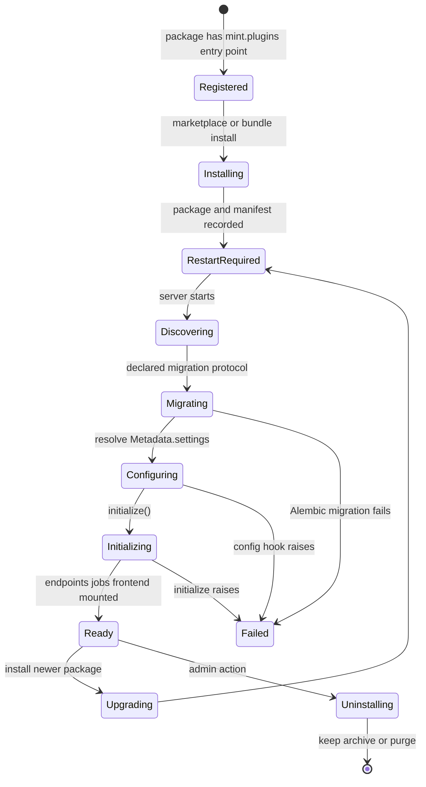

# Plugin lifecycle

This page shows what the platform does with a plugin from install to uninstall, and which plugin code runs at each phase. Put schema setup in migrations, startup resources in `initialize()`, settings side effects in `@on("settings")`, status reports in `@health`, and route logic in `@endpoint` handlers or native routers.

## State diagram



## Phase by phase

### Registered

You publish the plugin as a `.mint` bundle. Its Python wheel declares an entry point in the `mint.plugins` group:

```toml
# pyproject.toml
[project.entry-points."mint.plugins"]
my-plugin = "my_plugin.plugin:MyPlugin"
```

The entry-point name is the install slug (URL-safe, with hyphens). The right side is the dotted import path to the `Plugin` subclass. The group must be `mint.plugins`. The platform does not discover a plugin that declares `mld.plugins`, and it shows no error.

Put the package name, description, authors, homepage and license in the PEP 621 `[project]` table. Keep the dynamic `hatch-vcs` version configuration of the scaffold; the wheel records the package version from Git. Declare runtime behavior with a `Metadata` subclass and `@plugin`:

```python
from mint_sdk import Metadata, Plugin, plugin

class PeakQcMeta(Metadata):
    domain = "lcms"
    prefix = "/peak-qc"

@plugin(PeakQcMeta)
class PeakQcPlugin(Plugin):
    ...
```

The platform discovers entry points at every startup when `plugins.loadFromEntryPoints` is `true` (the default).

### Installing

An install starts from **Admin → Plugins → Registry → Install**, from a bundle upload, or from `POST /api/marketplace/install/{plugin_name}`. See [Who can install](/admin/plugins#who-can-install). The platform:

1. Gets the `.mint` bundle from an upload or from a GitHub Release that the registry links.
2. Checks the marketplace `min_platform_version` and the bundle `[tool.mint].requires_mint`.
3. Refuses a plugin wheel whose `mint-sdk` requirement excludes the platform SDK.
4. Compiles the requirements of all in-process plugins against the platform lock (`uv pip compile --generate-hashes --only-binary :all:`). A failed compile is the conflict check.
5. Applies the new `plugins.lock` and records the source artifact in the plugin manifest.
6. Keeps the ten most recent previous locks for rollback (`mint platform plugin snapshots` and `mint platform plugin rollback`).

At the first start of a new platform release, the platform compiles the plugin requirements against the new platform lock again. It disables a plugin whose requirements no longer resolve. Admin → Plugins shows the reason.

Most installs report that a server restart is necessary. Until the restart, the package is installed but does not serve traffic.

### Migrating

At startup, the platform prepares the database before it resolves the settings and calls `initialize()`. It applies the Alembic revisions of `Metadata.database` under its migration lock. See [Migrations](/sdk/concepts/migrations) for failure and recovery.

### Configuring

When the `Metadata` sets `settings = SettingsModel`, MINT loads the stored plugin settings and validates them with the Pydantic model. It then runs the matching `@on("settings")` handlers before `initialize()`.

```python
from pydantic import BaseModel, Field
from mint_sdk import Metadata, Plugin, SettingsChange, on, plugin

class PeakQcSettings(BaseModel):
    min_signal: float = Field(1000, ge=0)

class PeakQcMeta(Metadata):
    domain = "lcms"
    prefix = "/peak-qc"
    settings = PeakQcSettings

@plugin(PeakQcMeta)
class PeakQcPlugin(Plugin[PeakQcSettings]):
    @on("settings")
    def apply_config(self, change: SettingsChange[PeakQcSettings]) -> None:
        self._min_signal = change.current.min_signal
```

A settings hook that fails at startup stops the plugin initialization. Keep settings side effects in this hook. Do not create a second plugin-owned config file for integrated mode.

### Initializing

The host attaches `self.context` and then calls `await plugin.initialize()`:

- `initialize()` takes no argument. `self.context` is a `PlatformContext` when integrated and a `StandaloneContext` when standalone. It is never `None`; use `self.is_standalone` to branch.
- Use the hook to open external clients, fill caches and use the validated typed settings.
- The platform mounts the routes only after the hook returns.
- Raise `PluginLifecycleException` (or any exception) to stop initialization.
- Override the hook only when the plugin owns startup resources.

```python
from mint_sdk import Plugin
from mint_sdk.exceptions import PluginLifecycleException

class MyPlugin(Plugin):
    async def initialize(self) -> None:
        if not self._validate_config():
            raise PluginLifecycleException(
                "MyPlugin requires 'thresholds' in plugin settings",
                phase="initialize",
                plugin_name=self.name,
            )
```

### Ready

The SDK resolves all plugin surfaces, and MINT mounts them under `routes_prefix`:

| Surface | How authors declare it |
|---------|------------------------|
| HTTP endpoints | `@endpoint.get/post/...` or native `routers()` |
| Experiment-scoped route groups | `@endpoint.group(..., scope="experiment")` |
| Jobs | `@job(Spec)` methods, mounted under the SDK-owned jobs runtime |
| Generated UI | `ui = "generated"` plus generated job and result metadata |
| Frontend assets | The packaged frontend build, detected automatically |
| Native routers | `RouterMount` from `routers()`, when `@endpoint` is not enough |
| MCP | `@tool`, `@prompt`, `@resource` (`mint_sdk.mcp`) |

Users whose role has `plugins.use` and can see the plugin now see its tile. Each endpoint, job, tool and page then applies its `access` level (`use`, `configure`, `admin`). HTTP requests start to arrive.

While the plugin is ready, the platform or the SDK runtime can also call:

| Hook | When |
|------|------|
| `@health` | Periodically from the platform at `GET /__mint/health`, and on demand from admin status |
| `@on("experiment.before_save")` | Before a platform design-data save; can veto the write |
| `@on("experiment.after_save")` | After the platform commits a design-data save |
| `@on("experiment.status_changed")` | After the platform commits a status change such as `ongoing -> completed` |
| `@on("experiment.created")`, `@on("experiment.updated")`, `@on("experiment.deleted")` | After the platform commits the write |
| `@on("<plugin>.<event>")` | An event of this plugin, or a bus event of a plugin in `reads_from` |
| `@on("settings")` | When plugin settings are saved, reset or applied at startup |
| `@notify` | When plugin code returns a typed notification event |
| `@calendar_event` | When plugin code returns or cancels a typed calendar event |

A plugin gets only the events that it declares with `@on`. The writing plugin does not get the events of its own write. All observer events come through the durable event bus; see [Experiment events](/sdk/concepts/plugin-communication#experiment-events).

### Upgrading

A marketplace upgrade is a package install followed by a load cycle:

1. Install the new wheel.
2. Record the new manifest and registry metadata.
3. Report that a restart is necessary when the new code is not active yet.
4. At restart, discover the new entry-point metadata.
5. Run the new migrations.
6. Resolve the settings, run the startup hooks, call `initialize()` and mount the surfaces.

A marketplace update does not replace the running plugin in place. Until the server reloads, an installed package shows as **Installed but not loaded yet** or **Pending restart**.

A plugin built for an older SDK cannot load on a newer platform. At the first start of a new minor release, the platform disables an in-process plugin whose wheel excludes the platform `mint-sdk` and uninstalls its packages. A plugin process whose cached wheel excludes it does not start. The plugin data stays. Install a release of the plugin for the new SDK to enable it again; `GET /api/plugins` shows the reason in `dependency_lock`. See [Versioning](/sdk/operations/versioning#declare-compatibility-deliberately).

### Uninstalling

The admin UI and the CLI remove the package and keep the plugin-owned tables. The `archive` mode renames the plugin schema, and the `purge` mode drops it. See [Uninstall modes](/admin/plugins#uninstall-modes).

## Shutdown and resource cleanup

When the host stops or unloads the plugin, close the clients and tasks that the plugin owns in `shutdown()`.

```python
import httpx
from mint_sdk import Plugin

class MyPlugin(Plugin):
    async def initialize(self) -> None:
        self._http = httpx.AsyncClient(timeout=20.0)

    async def shutdown(self) -> None:
        await self._http.aclose()
```

## Typed events and their limits

Declare handlers with `@on`. The platform sends `experiment.before_save` to every plugin that declares it, so a validator must check only its own design payload:

```python
from mint_sdk import BeforeExperimentSave, EventVetoException, on

@on("experiment.before_save")
async def validate_design(self, event: BeforeExperimentSave) -> None:
    if event.data.get("plugin_id") != self.name:
        return None
    payload = event.data.get("data", {})
    if not payload.get("samples"):
        raise EventVetoException("Add at least one sample")
```

For platform design saves, `event.data` is `{ "plugin_id": ..., "data": ... }`, not the inner design payload. Typed events also give `experiment_id` and, when present, `experiment`, `request_id` and `actor`. Do not expect the optional fields on every host path.

`experiment.before_save` blocks the save and fails closed. Return `None` to allow the save. Raise `EventVetoException` to refuse it (422). These conditions also refuse the save:

- The handler fails, also in an in-process plugin.
- The handler returns a value other than `None`.
- For a plugin process, a Docker-managed runtime or an external HTTP runtime: the runtime is unreachable, times out, has no token or answers with an error status. The platform sends the event to these runtimes at `/__mint/events`.

The other `experiment.*` handlers are observers. They run after the commit, so a failure does not roll back the operation, and the event bus delivers the event again. Make them idempotent. For live-design patches and the `after_save` timing, see [Experiment events](/sdk/concepts/plugin-communication#experiment-events).

These events come from the platform services, not from database triggers. The platform design-save path (REST, MCP and plugin writes) runs the hooks of the other plugins. To enforce a rule on every design write, declare `Metadata.design` with a schema; the platform validates every `design.save` against it. Do operation-specific validation before you call a repository. Keep hooks fast, and do not save the same design again from its own event handler.

For a plugin event, use a name in the plugin namespace: `await self.context.publish("my-plugin.refreshed", payload)` with a matching `@on("my-plugin.refreshed")` observer. The name must start with the normalized plugin name. Declare the event in `Metadata.emits` to send it to other plugins through the event bus; see [Event bus](/sdk/concepts/plugin-communication#event-bus). With `"realtime"` in `Metadata.features`, `publish` also streams the event to the browser; see [Python SDK](/sdk/api/python#events-health-and-realtime).

## Settings revisions and runtime changes

`@on("settings")` receives a `SettingsChange[Settings]` with the current typed settings, the previous settings when available, the source and the fields that the caller supplied. The startup hooks run before `initialize()`; later saves run the same side effects. Do not write a hook that needs a client that `initialize()` has not opened yet.

```python
candidate = self.settings.model_copy(update={"min_signal": 1500})
await self.update_settings(candidate, replace=True, revision=self.settings_revision)

await self.update_settings({"min_signal": 1500})
```

The second call is a shallow partial update against the latest stored settings. A revision is an opaque content token (ETag), not an increasing number. A stale full replacement causes a conflict; it does not merge or retry. A patch is shallow, so a nested object that you supply replaces that field and is not merged into it. Settings revisions, package versions, Alembic revisions and design payload versions are separate values.

For a plugin in its own process (subprocess, Docker-managed or external HTTP), the platform sends a settings write to the plugin process. The plugin validates and stores the value and runs its `@on("settings")` handlers, so no restart is necessary. When the plugin process does not answer, the write fails with 503 and nothing is stored.

## Failed state

A plugin goes to **Failed** when:

- An Alembic migration fails, or the plugin still defines the removed `get_migrations_package()`. See [Migrations](/sdk/concepts/migrations).
- `initialize()` raises.
- The typed startup settings or their change hook fail.

Admin status shows a failed plugin with the reason. A failed plugin does not accept HTTP traffic. Ship a fixed release or fix the configuration, then restart the server so that startup runs again.

A health report is a runtime diagnostic. An unhealthy report alone does not unload the routes. Read the admin error and the logs for the actual failure.

## Hook reference

| Surface | Required | Default |
|---------|----------|---------|
| `mint.plugins` entry point | Yes | One entry that points to the `Plugin` subclass |
| `Metadata` + `@plugin(Meta)` | Yes | Declares runtime behavior; identity comes from `[project]` |
| `@endpoint` handlers | No | Ordinary HTTP routes |
| `routers()` | No | `[]`; native FastAPI routers |
| `initialize()` | No | No argument; override for owned resources |
| `shutdown()` | No | Does nothing |
| `@health` | No | Healthy |
| `@on(...)` | No | Experiment events, plugin events and `"settings"` |
| `Metadata.settings` | No | Typed settings model; enables `@on("settings")` |
| `Metadata.database` | No | `MigrationSpec` of the Alembic runtime; `None` means no owned tables |

Verified against [v@MINT_VERSION@ plugin lifecycle](https://github.com/MorscherLab/MINT/blob/v@MINT_VERSION@/packages/sdk-python/src/mint_sdk/plugin_base.py), [settings](https://github.com/MorscherLab/MINT/blob/v@MINT_VERSION@/packages/sdk-python/src/mint_sdk/plugin_settings.py) and [platform design-save service](https://github.com/MorscherLab/MINT/blob/v@MINT_VERSION@/api/services/experiment_service.py).
